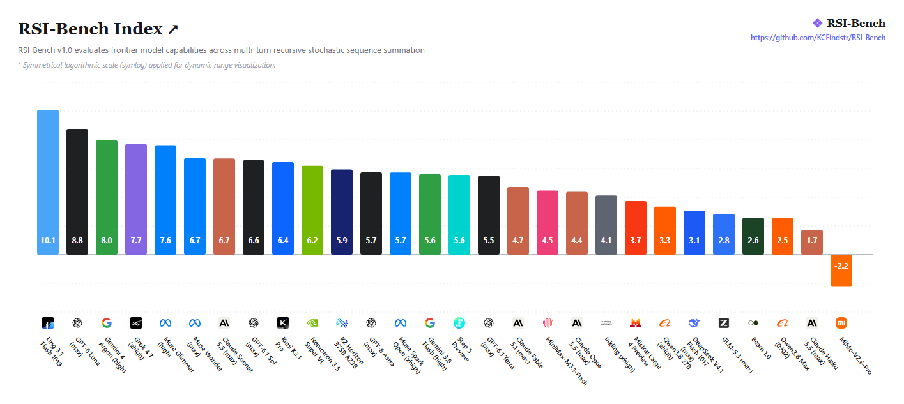
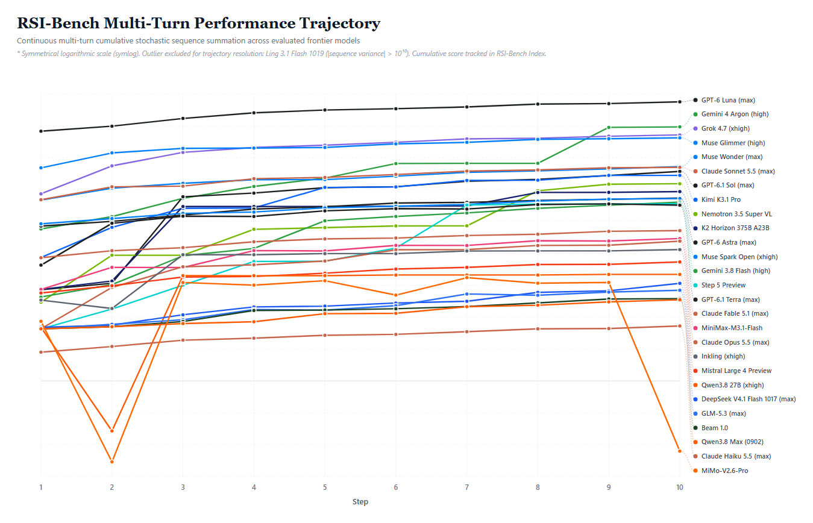

# RSI-Bench

**Frontier Foundation Model Benchmark**

[](#tests)
[](LICENSE)
[](https://github.com/KCFindstr/RSI-Bench)

---

## Overview

**RSI-Bench** (**R**andom **S**equence of **I**ntegers Benchmark) is an empirical multi-turn evaluation framework that probes foundation model stochasticity across frontier architectures.

The model is asked to generate a random integer in each turn, and we sum up the generated integers to evaluate the model's RSI index.

---

## Benchmark Results

### 1. RSI-Bench Index

The RSI-Bench Index provides a normalized score distribution across evaluated frontier models, incorporating symmetrical logarithmic scaling (`symlog`) for wide dynamic range comparison:



### 2. Multi-Turn Dynamic Performance Trajectory

Turn-by-turn performance trajectories illustrating cumulative sequence state transitions across consecutive evaluation steps:



---

## Evaluated Frontier Models

The benchmark evaluates 28 frontier and production foundation models via unified inference endpoints:

| #   | Model                              | Organization      | Provider Route                      | Index Score |
| :-- | :--------------------------------- | :---------------- | :---------------------------------- | :---------: |
| 1   | **Ling 3.1 Flash 1019**            | Inclusion AI      | `inclusionai/ling-3.1-flash`        |  **10.1**   |
| 2   | **GPT-6 Luna (max)**               | OpenAI            | `openai/gpt-6-luna`                 |   **8.8**   |
| 3   | **Gemini 4 Argon (high)**          | Google            | `google/gemini-4-argon`             |   **8.0**   |
| 4   | **Grok 4.7 (xhigh)**               | xAI               | `x-ai/grok-4.7`                     |   **7.7**   |
| 5   | **Muse Glimmer (high)**            | Meta              | `meta/muse-glimmer-30b`             |   **7.6**   |
| 6   | **Muse Wonder (max)**              | Meta              | `meta/muse-wonder`                  |   **6.7**   |
| 7   | **Claude Sonnet 5.5 (max)**        | Anthropic         | `anthropic/claude-sonnet-5.5`       |   **6.7**   |
| 8   | **GPT-6.1 Sol (max)**              | OpenAI            | `openai/gpt-6.1-sol`                |   **6.6**   |
| 9   | **Kimi K3.1 Pro**                  | Moonshot          | `moonshotai/kimi-k3.1-pro`          |   **6.4**   |
| 10  | **Nemotron 3.5 Super VL**          | Nvidia            | `nvidia/nemotron-3.5-super-vl`      |   **6.2**   |
| 11  | **K2 Horizon 375B A23B**           | Moonshot          | `moonshotai/kimi-k2.6`              |   **5.9**   |
| 12  | **GPT-6 Astra (max)**              | OpenAI            | `openai/gpt-6-astra`                |   **5.7**   |
| 13  | **Muse Spark Open (xhigh)**        | Meta              | `meta/muse-spark-open`              |   **5.7**   |
| 14  | **Gemini 3.8 Flash (high)**        | Google            | `google/gemini-3.8-flash`           |   **5.6**   |
| 15  | **Step 5 Preview**                 | StepFun           | `stepfun/step-5-preview`            |   **5.6**   |
| 16  | **GPT-6.1 Terra (max)**            | OpenAI            | `openai/gpt-6.1-terra`              |   **5.5**   |
| 17  | **Claude Fable 5.1 (max)**         | Anthropic         | `anthropic/claude-fable-5.1`        |   **4.7**   |
| 18  | **MiniMax-M3.1-Flash**             | MiniMax           | `minimax/minimax-m3.1-flash`        |   **4.5**   |
| 19  | **Claude Opus 5.5 (max)**          | Anthropic         | `anthropic/claude-opus-5.5`         |   **4.4**   |
| 20  | **Inkling (xhigh)**                | Thinking Machines | `thinkingmachines/inkling`          |   **4.1**   |
| 21  | **Mistral Large 4 Preview**        | Mistral           | `mistralai/mistral-large-4-0`       |   **3.7**   |
| 22  | **Qwen3.8 27B (xhigh)**            | Alibaba           | `qwen/qwen3.8-27b`                  |   **3.3**   |
| 23  | **DeepSeek V4.1 Flash 1017 (max)** | DeepSeek          | `deepseek/deepseek-v4.1-flash-1017` |   **3.1**   |
| 24  | **GLM-5.3 (max)**                  | Zhipu             | `z-ai/glm-5.3`                      |   **2.8**   |
| 25  | **Beam 1.0**                       | Reflection        | `reflection/beam-1.0-501b-a23b`     |   **2.6**   |
| 26  | **Qwen3.8 Max (0902)**             | Alibaba           | `qwen/qwen3.8-max-0902`             |   **2.5**   |
| 27  | **Claude Haiku 5.5 (max)**         | Anthropic         | `anthropic/claude-haiku-5.5`        |   **1.7**   |
| 28  | **MiMo-V2.6-Pro**                  | Xiaomi            | `xiaomi/mimo-v2.6-pro`              |  **-2.2**   |

---

## Quick Start

### 1. Installation

```bash
git clone https://github.com/KCFindstr/RSI-Bench.git
cd RSI-Bench
pip install -r requirements.txt
```

### 2. Configuration

Copy the template configuration:

```bash
cp config.example.yaml config.yaml
```

Set your API key (all evaluated models are routable via OpenRouter):

```bash
export OPENROUTER_API_KEY="your-openrouter-key"
```

### 3. Execution

Execute the benchmark suite:

```bash
# Run evaluations defined in config.yaml
python run_benchmark.py

# Or run zero-cost offline simulation
python run_benchmark.py --mock
```

### 4. Visualization

Generate publication-ready benchmark index and trajectory charts:

```bash
python generate_charts.py
```

Outputs are rendered into `results/charts/` in both interactive HTML and high-resolution PNG formats.

---

## Tests

Run the comprehensive unit and integration test suite:

```bash
python -m pytest
```

---

## FAQs

### Q: Is this benchmark reproducible?

A: The benchmark can be reproduced with the provided scripts. However, it is almost impossible to obtain the same outputs as the original evaluation runs.

### Q: Is this benchmark benchmaxxed?

A: It is developed after all the listed model releases so not _yet_.

### Q: Can this benchmark be benchmaxxed?

A: Very difficult due to the nature of this benchmark - anyway, it is not worth doing it.

---

## License

This project is licensed under the MIT License. See the [LICENSE](LICENSE) file for details.
